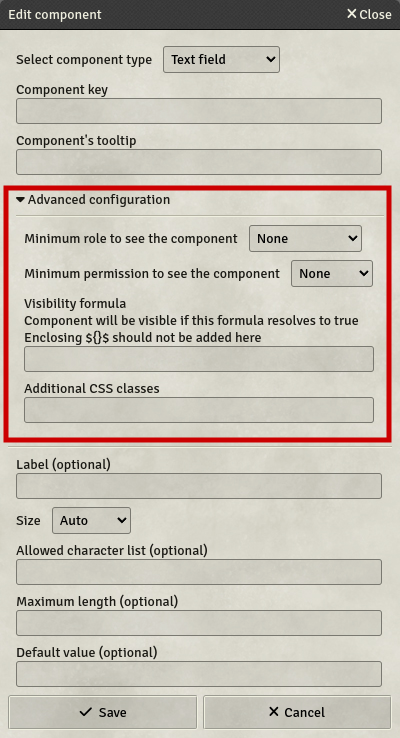

# Component Library

**REMINDER :** The key is sometimes optional, but if set it MUST be unique throughout the whole sheet to work properly. The key can only be composed of letters (upper and lowercase), numbers and underscores.

Each component can have a tooltip, which is a little text displayed when hovering the mouse over the component for some time. You can also use [formulas](./Guides/Formula-System).

Under the key and tooltip fields is an advanced configuration section, displayable by clicking on the Advanced configuration label. This section allows for more configuration options for the components.

Each component can be limited by the current player role and permission. To see a component, the user's role AND permission on the sheet must be above or equal to the minimum role and permission configured on the element. This allows you to create GM-Only Components or Tabs and limit the view of non-owner players on their companions' sheets for example.

Each component can be hidden depending on a [formulas](./Guides/Formula-System) result. This formula must not be enclosed in the `${}$` brackets, and it will only show the component if it resolves to `true`

Some components can display HTML entered in its fields. You can disable the rendering of this HTML in the tempalte view, in case the HTML is composed using Formulas and would be broken in templates.

You can add CSS classes on every component, which will be added to the rendered component on the sheet. See [here](./Tips-&-Tricks/Use-your-own-CSS) for more information on CSS enhancing.

## Component list

Here is the full list of components available in Custom System Builder.

### Computable Fields

- [Label](./Component-Library/Label): A short text, static or computed, displayed on the sheet.
- [Meter](./Component-Library/Meter): A meter displaying a constrained numeric value.

### Input Fields

- [Text field](./Component-Library/Text-field): A text input field, accepting any basic text.
- [Number field](./Component-Library/Number-field): A number input field, with specific controls adapted to numbers.
- [Rich text area](./Component-Library/Rich-text-area): A text area with formatting capabilities.
- [Checkbox](./Component-Library/Checkbox): A checkbox. To check things.
- [Picture](./Component-Library/Picture): An editable picture.
- [Radio buttons](./Component-Library/Radio-buttons): Mutually exclusive checkboxes. Only one can be checked at a time.
- [Dropdown list](./Component-Library/Dropdown-list): A list of options to choose from.

### Extensible Tables

- [Dynamic table](./Component-Library/Dynamic-table): A table with a predefined row layout, in which players can freely add new rows.
- [Item Displayer](./Component-Library/Item-Displayer): A table displaying items linked to a character and capabilities to display additional information.
- [Mirror Component](./Component-Library/Mirror-Component): An Item Displayer specific component used to mirror an item component on the actor sheet.

### Lists

- [Active Effect Displayer](./Component-Library/Active-Effect-Displayer): A table managing the current active effects of the character.
- [Conditional Modifier List](./Component-Library/Conditional-Modifier-List): A list of toggles for the available conditional modifiers of the players.

### UI-Structuring

- [Panel](./Component-Library/Panel): A container, with options to organize its contents.
- [Tabbed Panel](./Component-Library/Tabbed-Panel): A tab bar with a panel in each tab.
- [Table](./Component-Library/Table): A table with a predefined column and row count.
