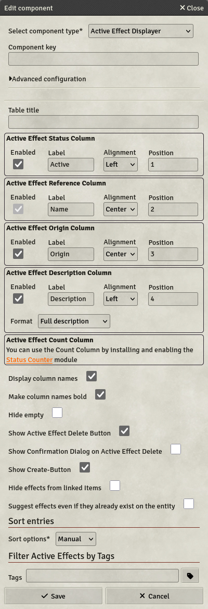

# Active Effect Displayer

Active Effect displayers are Components designed to display Active Effects applied to an Actor or to an Item, which is attached to the Actor.

[For more information on Active Effects, see here.](../Guides/Active-Effects)

- **Key**: Mandatory
- **Table Title**: A title to display on the top of the Displayer. This can contain HTML
- **Column configuration**: The next boxes configure the Active Effect Displayer looks. Each column can be toggled, except the Reference Column which displays the name of the Active Effects, and the header of each column can be configured. The position of each column can be altered, columns will be placed in order of position.
  - **Active Effect Status Column**: This column displays a checkbox which can be used to toggle the active effect.
  - **Active Effect Reference Column**: This column displays the name of the cative effect as a clickable button which opens the Active Effect Configuration Dialog.
  - **Active Effect Origin Column**: This column displays the item from which the Active Effect originates, if the Active Effect is derived from an Item.
  - **Active Effect Description Column**: This column displays the description field of the Active Effect. Two formats are available:
    - _Full description_: Displays the full description
    - _First sentence only_: Displays the description up until the first period or paragraph break
  - **Active Effect Count Column**: _Works only with the Status Counter module._ This column displays a NumberField linked to the current count for this active effect.
- **Display column names**: If set, column names will be displayed on the table. Can be unset to refine the display of Active Effects.
- **Make column name bold**: If set, column names will be bold on the table, to emphasize the head of the table.
- **Hide empty**: If set, the Displayer will be hidden it displays no Active Effects.
- **Show Active Effect Delete Button**: If set, each Active Effect will be accompanied by a Delete-Button, allowing players to delete their own Active Effects.
- **Show Confirmation Dialog on Active Effect Delete**: If set, a confirmation dialog will be shown on click on the delete row button, to avoid accidental Active Effect deletion.
- **Show Create-Button**: If set, a Create-Button at the bottom of the table will be shown, which will allow to create new Active Effects from there. A dropdown list will be displayed alongside the button to suggest [predefined Active Effects](../Guides/Active-Effects).
- **Hide effects from linked items**: If set, Active Effects transferred from Items will not be displayed in the Displayer.
- **Suggest effects even if they already exist on the entity**: If set, the Dropdown next to the create button will display every predefined Active Effect. By default, effects existing with the same name on the entity will not be suggested.
- **Sort options**: You can select 2 different sort-options: `Manual` and `Disabled`.
  - **Manual**: With this option on, players can click a column header to sort the Active Effects by this column.
  - **Disabled**: This option disables any sorting-behavior, so Active Effects are displayed in the order they are added to the sheet
- **Filter by tag**: You can add tags here to filter which active effects will be displayed in the displayer. Tags are evaluated with an "OR" operator, meaning any active effect containing at least one tag defined here will be displayed in the Displayer.
