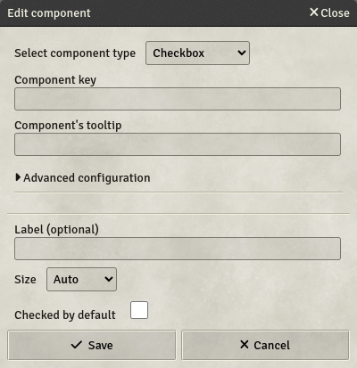

# Checkbox

Checkboxes are checkboxes. They return either `true` or `false`. Sometimes it's that simple.

- **Key**: Mandatory - will not save otherwise
- **Label**: If set, will display this label next to the checkbox on the sheet
- **Size**: Specifies the size of the field. 4 options are available:
  - **Auto**: The field will take all the available space, resizing automatically.
  - **Small / Medium / Large**: The field will have a fixed size, depending on your choice.
- **Checked by default**: The checkbox will be checked on new sheets
