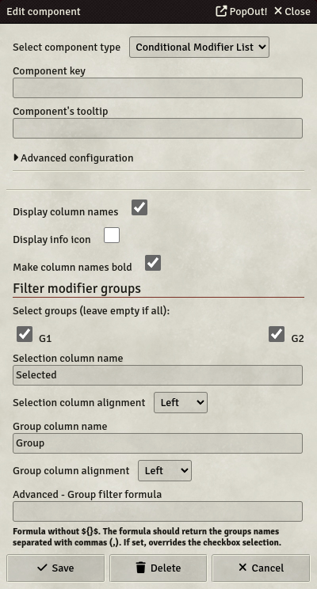

# Conditional Modifier List

> &#x26a0;&#xfe0f; **Starting from version 4.5.0, Item and Status Effect modifiers are deprecated in favor of [Active Effects](../Guides/Active-Effects), and will be removed in 6.0.0 and compatibility with Foundry 14.**

The Conditional Modifier List is a component, which can be used to list and select conditional modifier groups. Modifier groups can be created/edited in the modifier configuration of the corresponding items (see [Item modifiers](../Items#item-modifiers)). If you select a group, all modifiers from this group will be applied to the actor.

- **Key**: Optional
- **Display column names**: If set, column names will be displayed on the table.
- **Display info icon**: If set, will display an info icon, which will display the description of all modifiers of the group when hovering over with the mouse.
- **Make column names bold**: If set, column names will be bold on the table, to emphasize the head of the table.
- **Filter modifier groups**: You can filter modifier groups by selecting them. If you select none, filtering will not be applied, thus it will display all conditional modifiers
- **Selection column name**: The label name of the selection column.
- **Selection column alignment**: This setting allows you to configure the selection column alignment.
- **Group column name**: The label name of the group column.
- **Group column alignment**: This setting allows you to configure the group column alignment.
- **Advanced - Group filter formula**: You can filter modifier groups by having a Formula computing the groups that should be displayed. The formula should output the groups names, separated by commas `,`. It should not be enclosed in `${}$`. If a formula is set, the group selection made by checkboxes will not apply, being overridden by the Formula.

> &#x26a0;&#xfe0f; **Issues with the "Combat-Utility-Belt"-Module**
>
> If you had this module installed, chances are high, that you´ll get errors when trying to open the config-form. To fix that issue, you should run the following script in the console (F12):
>
> `game.actors.get('<ID>').update({system: {activeEffects: {"-=combat-utility-belt": true}}});` where 'ID' is the ID of the Template (not Actor). Alternatively you can use `.getName('<TemplateName>')` instead of `.get('<ID>')`.
