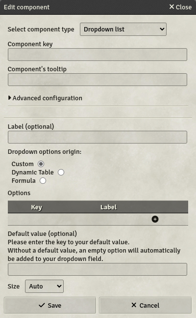

# Drop-down list

Drop-down lists are fields with limited options.

- **Key**: Mandatory - will not save otherwise
- **Label**: If set, will display this label next to the field on the sheet
- **Options to use from**: You can select how you want to populate the options in the dropdown-list.
  - **Custom**: Manually enter your options
  - **Dynamic Table**: Fetch options from Dynamic Table-columns
  - **Formula**: Fetch options from formulas.
- **Options**: The value list displayed in the sheet. Enter one key and one Label per row. You can only reference the value of the key in formulas, it's not possible to do so with the Label. But contrary to component keys, every character is allowed (including whitespaces).
- **Dynamic table key**: The source dynamic table's key. In items, it is possible to reference a parent's dynamic table by adding the `parent.` prefix in front of the key.
- **Column from the dynamic table to use as option key**: The key of the column in the dynamic table to use as options keys.
- **Column from the dynamic table to use as option label (optional)**: The key of the column in the dynamic table to use as options labels.
- **Formula for Key-Options**: The [formula](../Guides/Formula-System), which returns an Array of all option-keys, e.g. from `lookup()`. These can also be comma-separated values (CSV).
- **Formula for Label-Options** (optional): The [formula](../Guides/Formula-System), which returns an Array of all option-labels, e.g. from `lookup()`. These can also be comma-separated values (CSV).
- **Default value** (optional): If set, the drop-down list will select the `key` entered as default value. If not set, the drop-down list will include an empty option at the beginning of the list.
