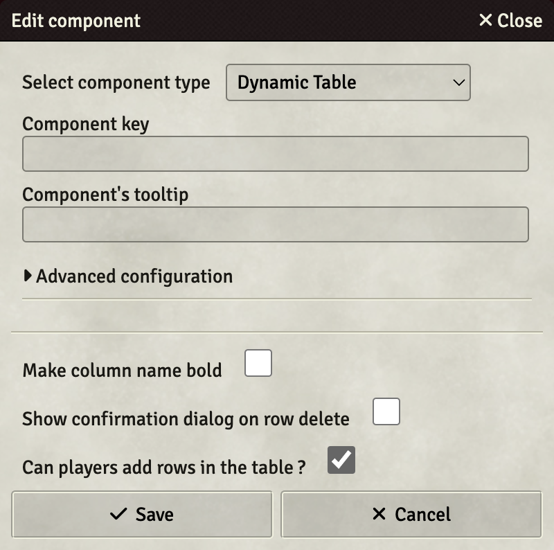
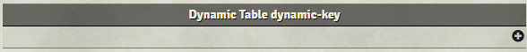
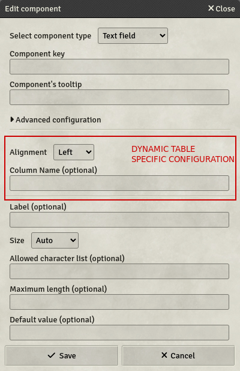

# Dynamic table

The Dynamic table is a component which allows players to make custom lists in their sheets with a layout specification.

- **Key**: Mandatory - will not save otherwise
- **Make column name bold**: If set, column names will be bold on the table, to emphasize the head of the table.
- **Show confirmation dialog on row delete**: If set, a confirmation dialog will be shown on click on the delete row button, to avoid accidental row deletion
- **Can players add rows in the table?**: If set, players will be able to add rows in their sheets. If not, only GMs & Assistant GMs will be able to.
- **Hidden columns**
  - **Key**: The column key of the hidden column.
  - **Formula**: The column formula, which will be resolved for each row of this table. The values can be retrieved with `sameRow('Key')` similar to visible columns.
- **Sort entries**
  - **Sort options**: You can select 3 different sort-options: `Auto`, `Manual` and `Disabled`.
    - **Auto**: This option allows you to sort entries automatically whenever the character sheet gets updated
    - **Manual**: With this option on, each entry will display arrows on the right side of the Table. With this, players can sort their entries however they like. Players can also click a column header to sort the table by this column.
    - **Disabled**: This option disables any sorting-behavior, so entries are displayed in the order they are added to the character sheet
  - **Add sorting criteria**: This will only be shown when `Auto` is selected. In here you can configure the sorting-behavior. You can add multiple criteria for sorting, but the sort-priority is determined by insertion order:
    - **Column key**: The column-key you want to sort after
    - **Operator**: The Comparison-Operator, which should be used for Sorting. `ASC` and `DESC` will sort the entries by natural order (`ASC`: 0-9, a-z; `DESC`: 9-0, z-a), while `==` and `!=` will prioritize those entries, which match the criteria
    - **Value**: The value to compare to. When using `ASC` or `DESC`, this is irrelevant.

Once created, the dynamic table will look like this in the template editor:

The `+` button in the header row is used to create new columns to the dynamic table. The dialog that opens is the same as panels, tabs and headers components, with two additional configuration settings:

- **Alignment**: How the column should be aligned in the dynamic table
- **Column name**: If set, will be displayed as the column's name

The `+`-button in the body of the table is used to create predefined lines. These lines will get added to the characters synchronized with the template. Each field can be filled with predefined data, which will be editable later by the players.

Each line will only be added once to every player. If a player were to delete the corresponding line in their sheet, there would be no built-in way to recover the line. Lines added after a character creation will however be added to the character sheet upon template reloading.

Each predefined line can be made permanent on the character sheet by activating the slashed trash icon at the end of the line. This setting will update existing predefined lines in character sheets upon template reloading.

The fields are not validated in the templates, it is up to the designer to make sure the data typed in the field is valid with the field's rules.
