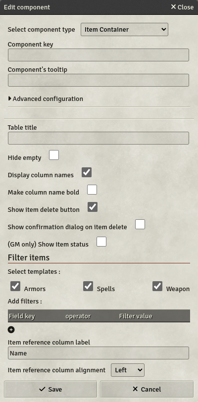
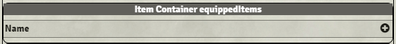

# Item Displayer

Item Displayers are components designed to display the items applied to an actor. Items can be filtered in the displayer to ensure sheet coherence, and specific information can be added next to the items.

- **Key**: Mandatory
- **Table Title**: A title to display on the top of the item displayer. This can contain HTML.
- **Item reference column label**: Every item displayer displays at least one column, which is a reference to the item. This setting allows you to configure its label.
- **Item reference column alignment**: This setting allows you to configure the reference column alignment.
- **Hide empty**: If set, The Item Displayer will be hidden if it displays no items.
- **Display column names**: If set, column names will be displayed on the table. Can be unset to refine the items display.
- **Make column name bold**: If set, column names will be bold on the table, to emphasize the head of the table.
- **Show item delete button**: If set, each item will be accompanied by a delete button, allowing players to delete their own items.
- **Show confirmation dialog on item delete**: If set, a confirmation dialog will be shown on click on the delete row button, to avoid accidental item deletion.
- **(GM only) Show status icon**: If set, GMs will see a status icon next to the item name, indicating if the item's template exists in the world. If the template exists, clicking this icon will open the template sheet.
- **Hidden columns**
  - **Key**: The column key of the hidden column.
  - **Formula**: The column formula, which will be resolved for each row of this displayer. The values can be retrieved with `sameRow('Key')` similar to visible columns.
- **Sort items**
  - **Sort options**: You can select 3 different sort-options: `Auto`, `Manual` and `Disabled`.
    - **Auto**: This option allows you to sort Items automatically whenever the character sheet gets updated
    - **Manual**: With this option on, each Item will display arrows on the right side of the Container. With this, players can sort their Items however they like. Players can also click a column header to sort the table by this column.
    - **Disabled**: This option disables any sorting-behavior, so Items are displayed in the order they are added to the character sheet
  - **Add sorting criteria**: This will only be shown when `Auto` is selected. In here you can configure the sorting-behavior. You can add multiple criteria for sorting, but the sort-priority is determined by insertion order:
    - **Field key**: The key of a column in the Item Displayer, or the key of an Item property (without the `item.`-prefix). If the entered key exists as both column key and item key, the column values will be used.
    - **Operator**: The Comparison-Operator, which should be used for Sorting. `ASC` and `DESC` will sort the Items by natural order (`ASC`: 0-9, a-z; `DESC`: 9-0, z-a), while `==` and `!=` will prioritize those Items, which match the criteria
    - **Value**: The value to compare to. When using `ASC` or `DESC`, this is irrelevant.
- **Filter items**
  - **Select templates**: You can select which item templates are eligible to be displayed in this container. This is a first filter for the container. If no templates are checked, no filter will be done on templates, only custom filters will apply.
  - **Item Filter Formula**: You can define additional filters by adding a Formula (without `${}$`). The Item Displayer will only display those Items, for which the Formula resolves to `true`. You can access item-properties with `item.<key>` (similar to Labels in Item Displayer).

Once created, the item displayer will look like this in the template editor :

The `+`-button is used to create new columns to the item displayer. The dialog that opens is the same as dynamic table components but with only Labels/Meters available. You can only configure Labels/Meters in item displayers, no value can be entered in this component.

As with any labels, you can use formulas in the Label text and Roll Messages. The keys used in the formulas will reference the parent keys, but you can use the item keys by adding `item.` in front of the key. For example, if a weapon's damage value is based on the character's `STRMod` and an internal `damage` value, you can display it in the item displayer with the formula `${STRMod + item.damage}$`.

Also, every entry in the Item Displayer comes with 3 hidden columns: `name`, `uuid` and `id`, which can be referenced from Formulas.

Lastly: If no additional columns are set and `Display column names` is unchecked in the Item displayer configuration, the items will be displayed as a vertical list without the table formatting.
