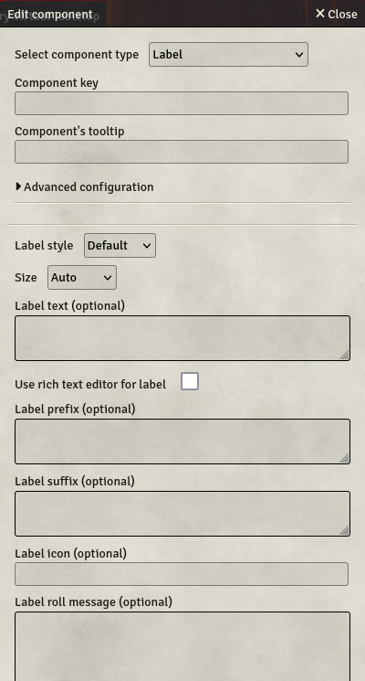

# Label

Labels are simple text rendered in the sheet. They can be dynamic, and they are able to trigger chat messages (including rolls).

- **Key** (optional): If set, allows the label text to be re-used in [formulas](../Guides/Formula-System) by referring to the key.
- **Label style**: You can choose the style of the label between title, subtitle, bold text, button and default. This will only affect the label's rendering.
- **Size**: Specifies the size of the field. 4 options are available :
  - **Auto**: The field will take all the available space, resizing automatically.
  - **Small / Medium / Large**: The field will have a fixed size, depending on your choice.
- **Label text**: The label's displayed text. Can use [formulas](../Guides/Formula-System).
- **Label prefix**: An optional prefix for the label. Is not used in the label's saved value. Can use [formulas](../Guides/Formula-System).
- **Label suffix**: An optional suffix for the label. Is not used in the label's saved value. Can use [formulas](../Guides/Formula-System).
- **Label icon**: You can add an icon in front of the label. Use a valid [fontawesome](https://fontawesome.com) icon name, like `dice-d20`.
- **Label roll message**: If set, will compute this text on a click on the Label. Can use [formulas](../Guides/Formula-System).
- **Send roll message to chat**: If checked, the roll message will be sent to the chat after computation. Can be unchecked if the roll message is a utility function.
- **Label alternative roll message**: If set, will compute this text on a click on the Label with the `Shift`-key pressed. Can use [formulas](../Guides/Formula-System). This allows for a standard roll to be set and an advanced one for special cases.
- **Send alternative roll message to chat**: If checked, the alternative roll message will be sent to the chat after computation. Can be unchecked if the alternative roll message is a utility function.
