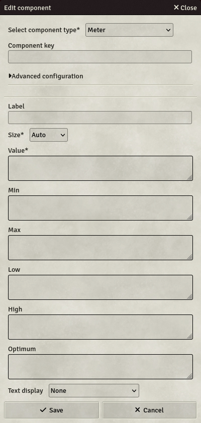

# Meter

Meter are gauges displayed on the field, with configurable values and behaviour.

- **Key**: Mandatory - will not save otherwise
- **Label**: If set, will display this label next to the field on the sheet
- **Size**: Specifies the size of the field. 4 options are available :
  - **Auto**: The field will take all the available space, resizing automatically.
  - **Small / Medium / Large**: The field will have a fixed size, depending on your choice.

**All fields below can contain formulas and should resolve to a number when computed**

- **Value**: The value displayed by the gauge. If the gauge has the key, this value is referencable in other Formulas.
- **Min**: The minimum value accepted by the gauge. If not set, defaults to 0.
- **Max**: The maximum value accepted by the gauge. If not set, defaults to 100.
- **Low**: An arbitrary low value in the gauge. If set without an optimum value, a value below this value will be displayed in yellow. Should be below the "High" value.
- **High**: An arbitrary high value in the gauge. If set without an optimum value, a value above this value will be displayed in yellow. Should be above the "Low" value.
- **Optimum**: An arbitrary optimum value in the gauge. This is only useful with High and Low values.
  - If set below the Low value, any value below the low value will be displayed in green, any value between Low and High will be displayed in yellow, and any value above High will be displayed in red.
  - If set above the High value, any value below the Low value will be displayed in red, any value between Low and High will be displayed in yellow, and any value above High will be displayed in green.
  - If set between the Low and High value, any value below the Low value will be displayed in yellow, any value between Low and High will be displayed in green, and any value above High will be displayed in yellow.
- **Text display**: Choose if and how the value should be displayed on the meter:
  - **None**: Will not display the value, and the meter will show slightly thinner.
  - **Show value**: Will show the raw value of the meter
  - **Show value and maximum**: Will show the value and the maximum formatted like this : `value / maximum`
  - **Show value as percentage**: Will calculate the percentage of the value between the minimum and the maximum values and display it.
