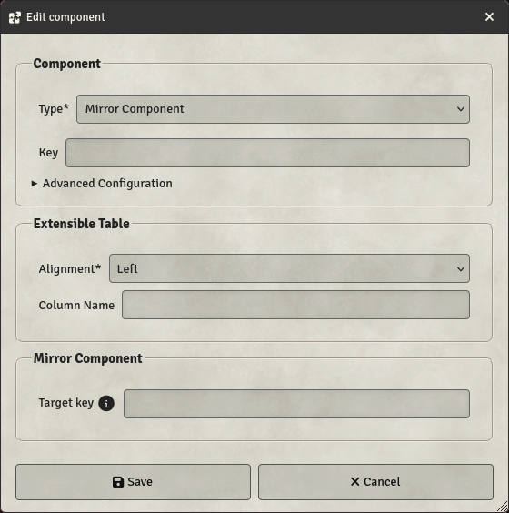

# Mirror Component

Mirror components are used to mirror a item component in an Item Displayer, which can be used to edit data in the Item.

- **Key**: Mandatory - will not save otherwise
- **Target key**: Key of the component to be mirrored. This must not include the `item.` prefix used in other Item Displayer fields formulas.
