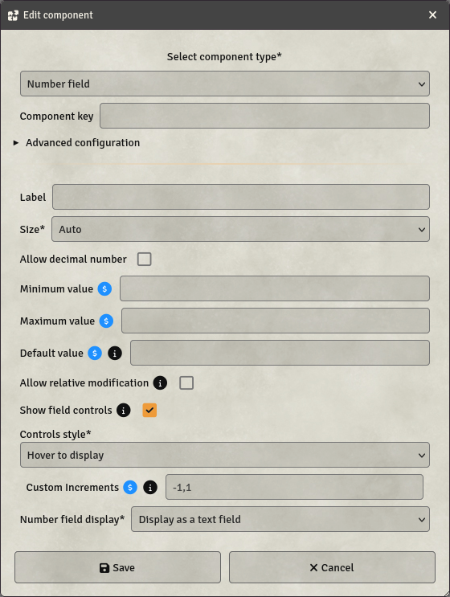

# Number field

Number fields are one-lined fields to input numbers.

- **Key**: Mandatory - will not save otherwise
- **Label**: If set, will display this label next to the field on the sheet
- **Size**: Specifies the size of the field. 4 options are available:
  - **Auto**: The field will take all the available space, resizing automatically.
  - **Small / Medium / Large**: The field will have a fixed size, depending on your choice.
- **Allow decimal number**: Allows decimal numbers to be entered. Accepted numbers are integer only by default.
- **Minimum value**: Sets the minimum value (inclusive) accepted in the field. This can be a [formula](../Guides/Formula-System).
- **Maximum value**: Sets the maximum value (inclusive) accepted in the field. This can be a [formula](../Guides/Formula-System). If a maximum value is set, the system will automatically create an Attribute Bar, which can be selected in the configuration of the Token
- **Default value**: If set, the field will have this value by default when the component is getting created
- **Allow relative modification**: If set, when a player enters `+x` or `-y`, the operation will be done relative to the current value of the field instead of directly setting the new value.
- **Show field controls**: If set, Buttons next to the field will be displayed to edit its value, based on the `Controls style`-setting.
- **Controls style**: Choose the style you want for the controls
  - **Hover to display**: Number field will have a `+` and `-` button shown when mouse is over them to increment and decrement the value.
  - **Full controls**: Number field will have `-10`, `-1`, `+1`, `+10` buttons around it, always displayed, to edit its value by the indicated amount.
- **Custom increments**: You can edit the buttons increment values with this field. You must add every possible increment, separated by commas. This can be a [formula](../Guides/Formula-System). For example, to have buttons to increment / decrement by 10 and 5, you need to set this to `-10,-5,5,10`.
- **Input style**: Choose the style you want for the number field
  - **Display as a text field**: Displays as a standard text field.
  - **Display as a slider**: Displays as a range selector, like a volume slider.
