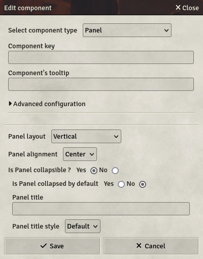
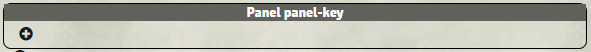

# Panel

Panels are invisible containers designed to display other components in a specific layout.

- **Key**: Optional
- **Panel layout**: Sets the future components layout in the panel
  - **Vertical**: Components will display vertically, one after the other, taking all the available width.
  - **Horizontal**: Components will display horizontally, from left to right.
  - **Grid**: Components will display horizontally, in lines of n components.
- **Panel alignment**: Sets the alignment of the components
  - **Center**: Will center all components in their virtual column
  - **Left**: Will place components on the left, leaving a space on the right of the panel
  - **Right**: Will place components on the right, leaving a space on the left of the panel
  - **Justify**: Will center components in their columns, but will not leave space in the left and right of the panel.
- **Is Panel collapsible?**: Should the panel be collapsible in the sheet?
- **Is Panel collapsed by default?**: Should the panel be collapsed in the sheet on the first display?
- **Panel title**: The Panel title to toggle collapsed state
- **Panel title style**: The style of the Panel title

Once created, the panel will look like this in the template editor:

The `+` button is used to add new components to the panel, in the same way as the body and header. The panel's header indicates the panel's key for reference, and will not be shown in the definitive sheets, nor will be the outline. The panel's header is used to edit the panel's settings.
