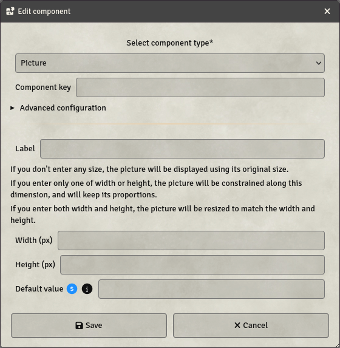

# Picture

Pictures are components allowing your players to set custom pictures in their sheet. They require a key, and can be used in Formulas.

- **Key**: Mandatory - will not save otherwise
- **Label**: If set, will display this label next to the picture on the sheet
- **Width**: If set, the picture will be resized to match this width.
- **Height**: If set, the picture will be resized to match this height.
- **Default value**: If set, the picture will be preset to this value on sheet creation. This can be a formula, but must resolve to a picture path in the end.

**Width** and **Height** can be used to alter the final display. If only one is set, the image will be resized along the set dimension and retain its original proportions. If both are set, the image will be resized to match both dimensions, which can result in some distortion.
