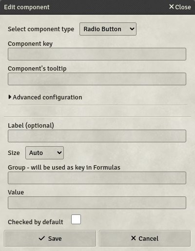

# Radio buttons

Radio buttons are checkboxes in a group, where only one can be selected at a time. They return the value of the selected one.

**WARNING :** Contrary to other components, the value of a radio buttons group is obtained in Formulas by using the name of the group, not the key to the radio buttons.

- **Key**: Mandatory - will not save otherwise
- **Label**: If set, will display this label next to the radio button on the sheet
- **Size**: Specifies the size of the field. 4 options are available:
  - **Auto**: The field will take all the available space, resizing automatically.
  - **Small / Medium / Large**: The field will have a fixed size, depending on your choice.
- **Group**: The group of radio buttons this button belongs to. Only one radio button of this group can be selected at a time. The group is also the key to use in Formulas. Mandatory - will not save otherwise
- **Value**: This radio button's value when selected. This can contain [formulas](../Guides/Formula-System).
- **Checked by default**: Whether this radio button should be checked by default in the sheet. If multiple radio buttons are to be checked by default in a single group, only the last one will really be checked in the character's sheets.
