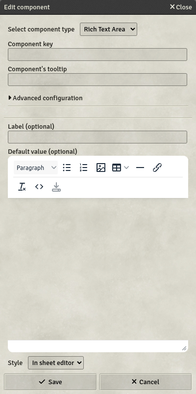

# Rich text area

Rich text areas are fields that can contain enriched HTML data. They come with a WYSIWYG-editor.

- **Key**: Mandatory - will not save otherwise
- **Label**: If set, will display this label next to the field on the sheet
- **Default value**: If set, the field will have this value by default
- **Style**: Three styles are available
  - **In sheet editor**: Rich text will be displayed on the sheet, with a button to open the editor directly within the sheet
  - **Dialog editor**: Rich text will be displayed on the sheet, with a button to open a pop-up dialog containing the editor
  - **Icon only**: Only an icon to open a pop-up dialog containing the editor will be displayed on the sheet. Useful for tight spaces
