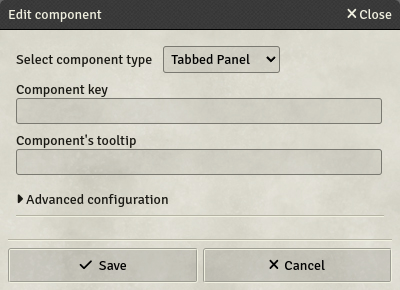
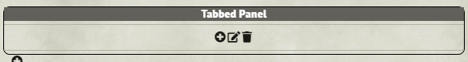
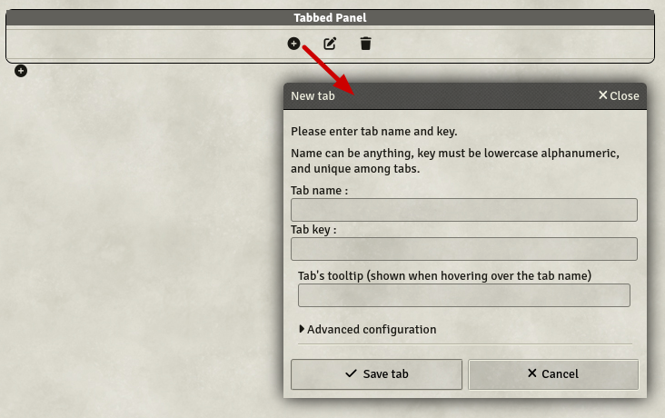
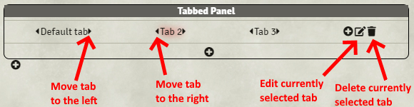

# Tabbed Panel

Tabbed Panels are containers designed to display other components in predefined tabs.

- **Key**: Optional

Once created, the panel will look like this in the template editor:

The panel's header indicates the panel's key for reference. It will not be shown in the definitive sheets nor will be the outline. The panel's header is used to edit the panel's settings.

To add a tab to your sheet, click the `+` icon in the tab selector section. This opens a pop-up dialog to let you enter the tab details.

You must enter the tab name, which can be anything, and the tab key.

You can edit the currently selected tab name and key with the edit button on the right, as well as delete it. Additionally, you can reorder your tabs using the arrows on the left and right of the tab name.

