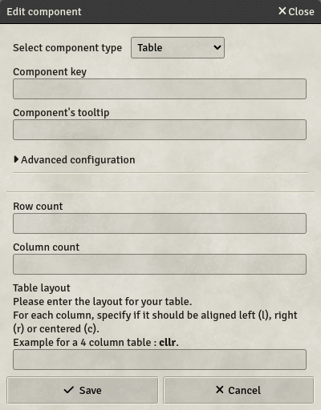
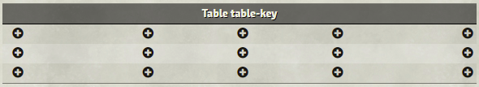

# Table

Tables are strict containers with specified column and row counts.

- **Key**: Optional
- **Row count**: How many rows should the table have?
- **Column count**: How many columns should the table have?
- **Table layout**: This is a code to specify the columns' alignment. Each column has 1 letter in the code, which indicates if the column should be aligned to the left (`l`), to the right (`r`) or centered (`c`).

Once created, the table will look like this in the template editor :

The `+`-buttons are used to add new components to the tables' cells, in the same way as the tabs and header. The tables' header indicates the tables' key for reference and will not be shown in the definitive sheets, nor will be the outline. The tables' header is used to edit the tables' settings.
