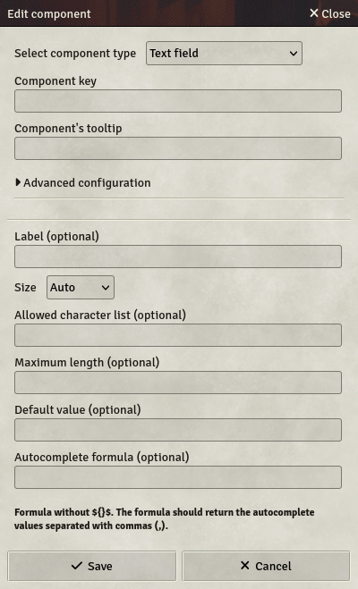

# Text field

Text fields are one-lined fields to input any string you want.

- **Key**: Mandatory - will not save otherwise
- **Label**: If set, will display this label next to the field on the sheet
- **Size**: Specifies the size of the field. 4 options are available:
  - **Auto**: The field will take all the available space, resizing automatically.
  - **Small / Medium / Large**: The field will have a fixed size, depending on your choice.
- **Allowed character list**: Specifies a list of characters authorized in the field. Inputs with other characters will be rejected.
- **Maximum length**: Sets the maximum number of characters allowed in the text field.
- **Default value**: If set, the field will have this value by default when the component is getting created
- **Autocomplete formula**: If set, the text field will provide autocompletion options on input, without enforcing them. The field should contain the groups' names, separated by commas `,`. It can contain Formulas.
