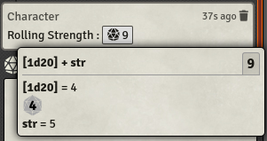
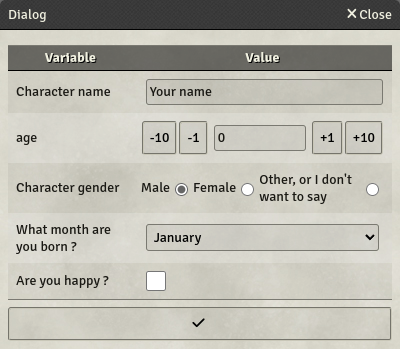

# Chat Messages

You can add Formulas in Chat Messages triggered from Components, like Labels. Doing so helps you automate your system even more, enabling you to use the characters data in a more interactive way. Formulas in Chat Messages have some more functionalities compared to sheet Formulas.

## Add rolls

> &#x2139;&#xfe0f; The roll system is compatible with the Dice so Nice module!

You can use rolls in your formulas. To do so, inside the formula markers, use brackets (`[` and `]`) to define your rolls. In roll expressions, you can also use keys, but you must surround them with colons. Rolls are performed using FoundryVTT Roll API.

For example, to roll for Shadowrun's Strength, you can define the following formula : `${[:STR:d6cs>=5]}$`.

Roll operations can be defined inside the roll, or outside. In terms of pure result, `${[1d20 + 3]}$` and `${[1d20] + 3}$` are equivalent, but I would recommend using the latter.

You can add an exclamation point at the start of you roll to display every dice of the roll directly in the chat message. For example : `${[!2d10]}$`.

You can also use Roll Tables, using the syntax `[#<rollTableName>]`. Just put a `#` before your roll table name, inside brackets, and the system will roll its default formula and integrate the result in the message.

You can customize the Roll Table formula by adding a Roll formula in this syntax : `[#<rollTableName>|<rollFormula>]`. The formula must follow roll formula syntax, with `::` to delimit the keys. This formula can be a Dice roll or a constant value, the latter will always draw the same result from the Roll Table.

When used in chat messages, formulas are explained by a small box displayed on click.



> &#x26a0;&#xfe0f; **Rolls can be used only in messages, not in label values.**

## User inputs

Sometimes you will need to ask your players for input when computing a Label message. You have two ways of doing so : You can use simple prompts, or craft a more complex User Input Template.

### Simple prompts

#### Syntax

```CSB Formula
?{<varName>[:<Display Name>][varType][|<defaultValue>]}
?{<varName>[:<varType>][|<choice1>[:<display 1>]|<choice2>[:<display 2>]|<choice3>[:<display 3>]|...]}
```

You can ask for user inputs in formula using the syntax `?{<varName>}`. This will open a pop-up dialog during formula computing asking for all the inputs in the formula.

You can specify an alternative name in the dialog by adding a colon and typing your sentence. This display name is a formula without the enclosing `${}$`. If you wish to just set a character string, it should be enclosed in quotes `'`.

You can add a default value by adding it after a vertical bar, like so : `?{<varName>|<defaultValue>}`. The `defaultValue` is a formula, without the enclosing `${}$`. If `defaultValue` is a character string, it should be enclosed by quotes `'`.

You can set the input to be a choice by adding more options after the vertical bar. In that case, the input will be a dropdown list, with all your choices. The first choice will be selected by default. Each choice can have a value and a displayed text, by adding a colon and a formula after the value in the choice. The value and the displayed text are formulas without the enclosing `${}$`. If you wish to just set a character string, it should be enclosed in quotes `'`.

You can also set a type for the field by specifying it between brackets after the input name and the displayed name. The type can be `text`, `number` or `check`. `text` is the default.

`text` and `check` types support multiple choices, resulting in respectively a dropdown list and radio buttons. `number` is displayed as a text field, in which only numbers can be typed, and scrolling adds or substracts to its value.

The user inputs variables can be reused later on as keys in the same message.

> &#x26a0;&#xfe0f; \*_User inputs can be used only in messages, not in label values._

#### Examples

```CSB Formula
${#concat(
?{name:"Character name"[text]|"Your name"},
?{age[number]},
?{gender:"Character gender"[check]|"m","Male"|"f","Female"|"o","Other, or I don't want to say"},
?{month:'What month are you born ?'|"January"|"February"|"March"|"April"|"May"|"June"|"July"|"August"|"September"|"October"|"November"|"December"},
?{happy:"Are you happy ?"[check]}
)}$
```

Results in :



### User Input Templates

You can create a special kind of items called `userInputTemplates` to create your own custom input dialogs. You can add many components in the template, which will be rendered like an actor or item sheet when called upon, with a validation button added in the bottom.

To trigger it in a Label Roll Message, you can use the syntax `?#{<userInputTemplate name>}`. The template will be displayed using the actor or item data, if you want to use this data in Labels in the template. Any input field using a key already defined in the triggering actor or item will use its value as default value, but will not be saved in the actor or item.

## Hide formulas in chat messages

When using formulas in chat-messages, you can hide some formulas to perform preliminary calculations assigned to reusable variables. To do so, prefix your formula with `#`, for example :

`${#testResult := target - roll}$`

> &#x26a0;&#xfe0f; **Formula hiding can be used only in messages, not in label values.**

## Do not include explanation in chat message

When using formulas in chat-messages, you can use the Formula's result as is, without it being enclosed in the clickable box with the explanations. This can be useful if you want to call a macro with parameters calculated from Formulas. To do so, prefix your formula with `!`, for example :

`/myMacro ${!target - roll}$`

> &#x26a0;&#xfe0f; **Explanation hiding can be used only in messages, not in label values.**
