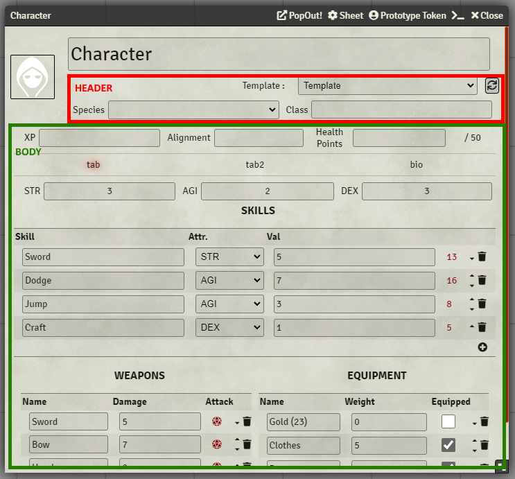
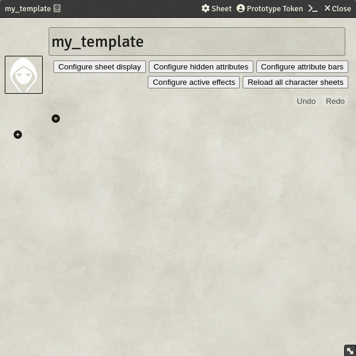
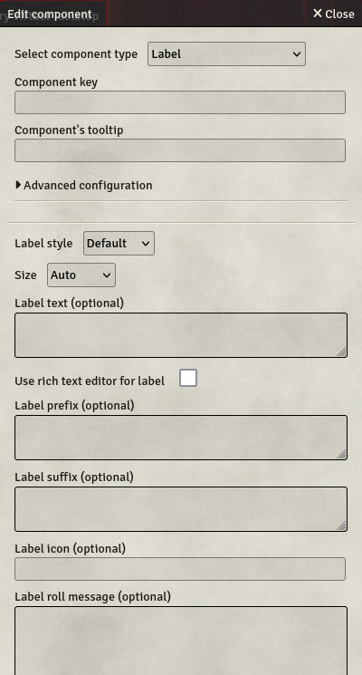
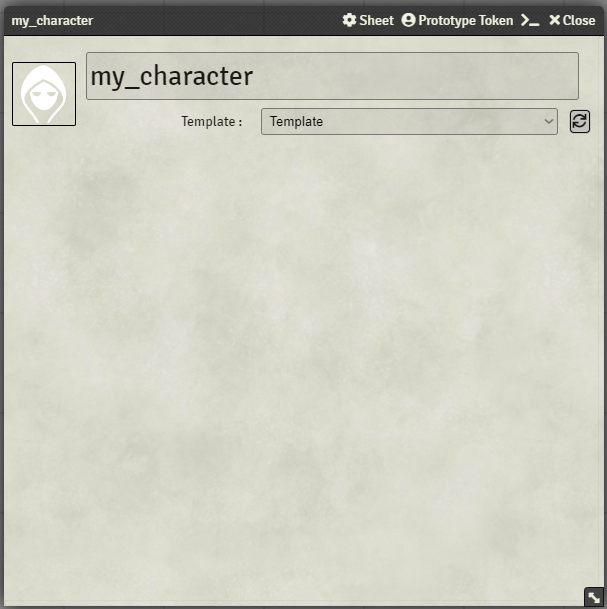

# Getting started

[[_TOC_]]

## 0. How to install the system

You can install the latest released version of the system by using the package manager in your FoundryVTT server! Alternatively, you can use this manifest link to install the system: `https://gitlab.com/custom-system-builder/custom-system-builder/-/raw/main/system.json`.

If you want to test the next version ahead of time, you can have access to the beta version with this manifest link: `https://gitlab.com/api/v4/projects/31995966/jobs/artifacts/beta/raw/out/system.json?job=build-beta`. The specific doc for the beta version is available here: [README_BETA.md](https://gitlab.com/custom-system-builder/custom-system-builder/-/blob/beta/README_BETA.md)

If you want to switch an existing world to the beta version, you can [follow this guide !](https://gitlab.com/custom-system-builder/custom-system-builder/-/wikis/Guides/Switch-to-Beta)

> &#x26a0;&#xfe0f; **Unstable version**
>
> Lastly, if you want to see the latest changes, at the risk of breaking your games, you can have access to the unstable version with this manifest link : `https://gitlab.com/api/v4/projects/31995966/jobs/artifacts/develop/raw/out/system.json?job=build-unstable`.
>
> Be aware that this version reflects the latest code in this repository, and thus can contain untested development, or breaking code. Please back-up your games regularly if you plan to use this version!

## 1. Before we start

The term `key` is used many times in this documentation. It refers to an identifier of fields or tabs. It must always be a string composed of letters (upper and lowercase), numbers and underscores only. Keys must be unique throughout the sheet.

This system defines two Actor types: Templates (`_template`) and Characters (`character`). The `_template` type is used to build and edit sheet structures while the `character` type uses a template to represent a Character. Just imagine that Templates are a blueprint, while Characters are an actual building.

## 2. Creating your first sheet

Sheets are divided into 2 main parts:

- The header, located under the actor's name and to the right of the character's profile picture
- The body, under both the header and the profile picture

The header and the body section both act in the same way, which is why they will be covered by the same section.

To create a sheet, start by creating a `_template` type actor first. The name of the Template should be unique, so that you won't get issues when trying to link a Template with a Character. Once your `_template` is created, the sheet will open and it will look like this:

### 2.1. Adding components to body and header

To add a component to the sheet structure, click the `+` icon in the section you want to add the component in. It will open a pop-up dialog asking for details for your new component.

You can start by selecting the component type you want to add. If you're unsure what a specific component is doing, you can always [check the component library](./Component-Library), in which all components are documented. For most components a key is mandatory. It will be used for various purposes, including saving the current value of the component under `system.props.<keyOfComponent>` and HTML-classes added to the component in the resulting sheets. Once you've finished the configuration, the component will be displayed on the Template. You can open the component configuration window again by clicking on the created component, in there you can perform changes or simply delete the whole component.

If you want to adjust the styling of your Components, you should check our section for [using your own CSS](./Tips-&-Tricks/Use-your-own-CSS).

To move the component in the sheet, you can drag and drop it where you want it to be. The component will be placed before the component you drag it onto, or at the end of the container if you drag it onto a + button. If you hold the CTRL-key (or CMD-key on Mac) while dragging, the component will be copied instead of being moved.

### 2.2. Creating a character

When your template is complete, you can associate it with a character. Create an actor with type `character`, and its sheet will open, looking like this.

.

On the top right of the sheet, a drop-down list allows you to select the template to use, and a button which applies the template. If you modify your template, you will need to click this button again to update the character sheet. This prevents any mistake deleting fields from the character sheets. This action is only available to GMs and Assistants by default but can be changed in the settings.

The reload action is also available in the context menu of the character in the actor directory on the right side of your window, though it just reloads the current template and does not allow for template selection.

## Next steps

For building your sheet structure, you should take a look at the [component library](./Component-Library).

For more options to configure the looks of your sheets and token behaviours, you can look over the [advance template configuration](./Template-Configuration).

To automate your sheets, you should take a look at the [Formula System](./Guides/Formula-System)

To learn about Items and their usefulness in CSB, dig into the [Item System](./Items)

If you want a complete sheet example, take a look at the [Example Sheet](https://foundryvtt.com/packages/custom-system-builder-example)
