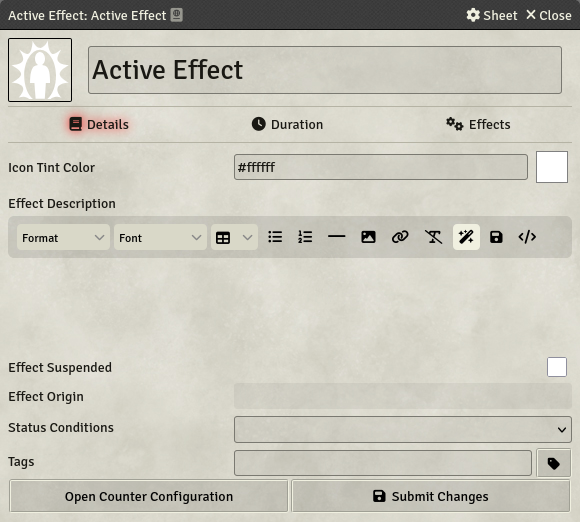
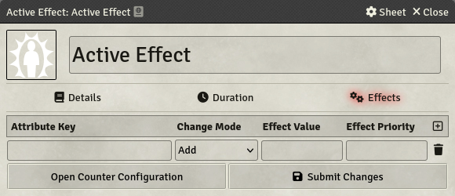
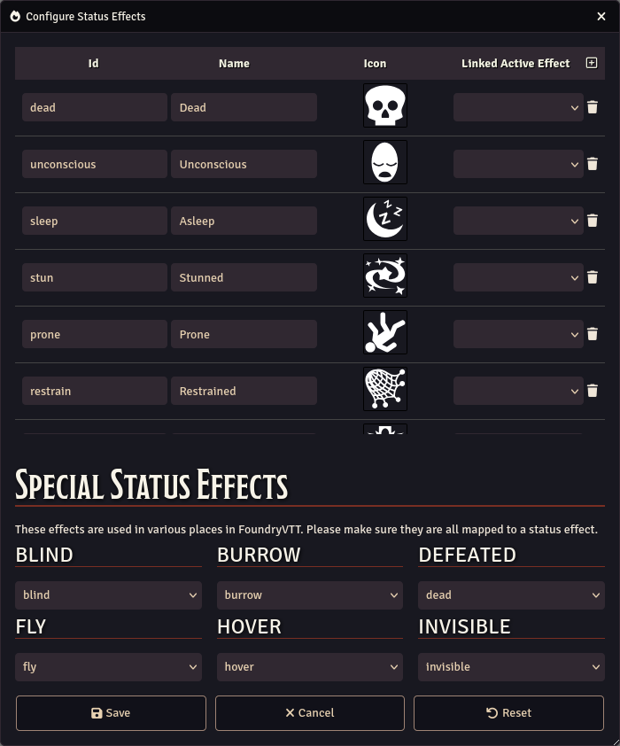
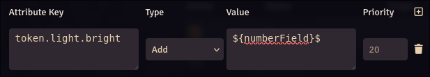
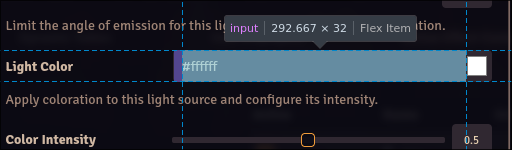
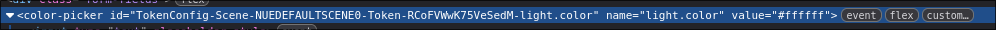

# Active Effects

[[_TOC_]]

## Introduction

Foundry Virtual Tabletop provides a convenient system for applying changes to characters (Actors) based on certain effects, equipment, spells, or other special traits that might give temporary benefits or downsides.

Custom System Builder allows you to define your own Active Effects easily to better customize your system. These Active Effects can be assigned to Items in addition to Actors, and can be transferred from an Item to an Actor if needed.

## Relevant Compatible Modules

Custom System Builder has special compatibility with two modules for Active Effects :

- [Status Icon Counters](https://foundryvtt.com/packages/statuscounter/): This module allows Active Effects to stack and disappear after a set amount of time.
- [DFreds Convenient Effects](https://foundryvtt.com/packages/dfreds-convenient-effects): This module creates an Active Effect Library to easily store and affect predefined Active Effects. CSB provides a basic version of this module Out Of The Box, but this module allows for more advanced Active Effect management.

Both these modules are optional, but recommended. This guide is written with Status Icon Counters active, because this module adds functionality not present in Custom System Builder.

## Create an Active Effect

To create an Active Effect on an Actor or an Item, you need to add an [Active Effect Displayer](../Component-Library/Active-Effect-Displayer) to its template, with the "Show Create Button" option enabled.

When viewing a sheet with this setup, you will see an array with the Active Effects assigned to the entity. You then can select a [Predefined Active Effect](#predefined-active-effects) in a Dropdown list at the bottom of the Active Effect Displayer, or create a new one with the "New active effect" option.

When clicking on the `+` button, a Dialog will open to let you create a new Active Effect.

You can configure many things on the Active Effect. One of the most important things to look at is the "Status Conditions" field. If you set one or multiple Status Condition to your Active Effect, its icon will appear on the character token when applied.

You can also add tags to the Active Effect, which can be used in the [Active Effect Displayer](../Component-Library/Active-Effect-Displayer) to filter displayed Active Effects.

On the Effects tab, you can configure Effects on the Active Effect. These effects will change the Target's data when the Active Effect is enabled.

Effects are configured with 4 fields :

- **Attribute Key**: This can contain Formulas, and must resolve to a Component Key in the Actor or Item it modifies.
- **Change Mode**: This affects how the effect changes the data.
  - **Multiply**: The attribute value will be multiplied by the Effect Value.
  - **Add**: The Effect Value will be added to the attribute value.
  - **Downgrade**: The attribute will be replaced by the Effect Value **only if** the effect value is lower than the current attribute value.
  - **Upgrade**: The attribute will be replaced by the Effect Value **only if** the effect value is higher than the current attribute value.
  - **Override**: The attribute will be replaced by the Effect Value.
  - **Custom**: Works like override, but the computation of the value has a `current` property, containing the current value of the affected attribute.
- **Effect Value**: This can contain Formulas, and is the value applied by the effect.
- **Effect Priority**: This must be an Integer, and affects the priority of the Effect. Every effect in the Entity (across all Active Effects) are applied in order of priority, lowest first.

Both Attribute Key and Effect Value fields can contain formulas. The properties available in the formula are those of the Active Effect's parent, i.e. the Actor or Item the Active Effect has been created on. The properties of the entity the Active Effect is applied to are available with the `target.` prefix.

## Template effects

You can create active effects on Templates. When reloading the template on an entity, Active Effects from the Template will be synchronized to the Active Effects in the entity.

## Predefined Active Effects

Predefined Active Effects are pre-existing Active Effects that can be easily applied to Entities. This allows you to configure your effects ahead of time, to have an ease of use during games.

You can manage Predefined Active Effects from two ways :

1. Click on the "Add to predefined" at the top of an Active Effect.
2. Use the Configure Active Effects button on the Settings Tab.

The Configure Active Effects button will open a window displaying all Predefined Active Effects. In this window, you can edit, delete or add new Predefined Active Effects.

## Customize Status Effects

Status Effects are the icons you can see when right-clicking a Token and clicking on "Assign Status Effects". When toggled, they create a Temporary Active Effect on the Character.

You can customize the Status Effects by using the "Configure Status Effects" button on the Settings Tab.

Each status effect must have an ID, a Name and an Icon to be valid.

You can link an Active Effect to each Status Effect. When toggling the Status Effect from a Token, the linked Active Effect will be added to the Character instead of the default generated Active Effect.

There are some special status effects in FoundryVTT, which are used by many systems. These special status effects act as shortcuts to actual status effects, and must be valid at all times to ensure a smooth experience. You can change these shortcuts in the status effect configuration, to toggle the right effect at the right time.

## About token values

Since Foundry 14, you can edit token values with Active Effects. To do so, you must configure the changes with the `token.` prefix.

To get the correct keys, you can use the inspector : Press F12 on Foundry, then click on the element picker, and then on the field you want the key of (it should turn blue when hovering on it). Then on the inspector, find the name attribute of the element to get its code. Here the name is `light.color` for example, so you would use `token.light.color` in your Active Effect.

