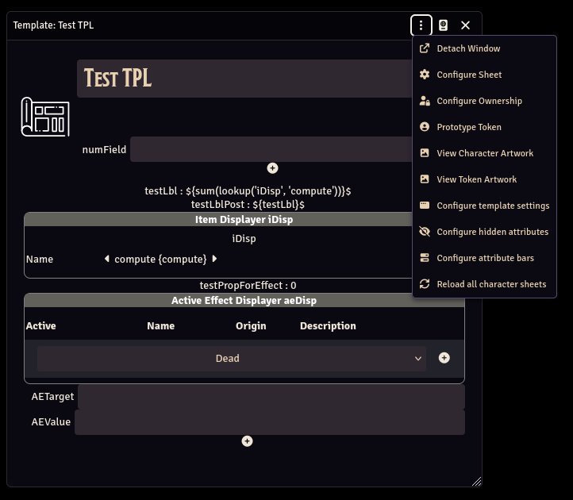
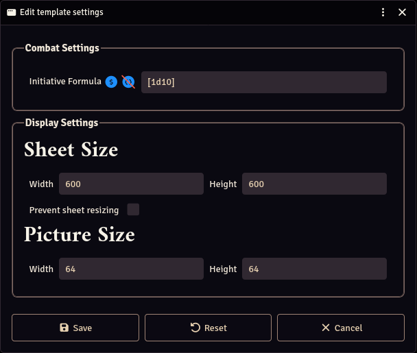

# Template configuration

You can configure your character's behavior in more detail than just the sheet layout. Here are some options to add more automation to your system.

## Configure your templates settings

You can configure various options in the template, with the `Configure template settings` button.

### Custom combat settings

Some combat settings can be overriden template by template.

- **Initiative Formula**: Set this to override the main initiative formula found in the system's settings. This formula must be formatted like a roll formula, returning only an integer. The `${}$` must not be set around the formula.

### Display settings

You can configure the sheet default display width and height and the profile picture size.

## Add complex attribute bars

You can add simple attribute bars by adding Number fields or Meters with a maximum value parameter. But what if your attribute bar's value is automatically calculated?

Then you just need to click the Configure Attribute Bars button in the template and add your attribute bar settings there. Each bar must have a Name, a Value and a Maximum. The Value and the Maximum can both be [formulas](./Formulas)!

> &#x26a0;&#xfe0f; Complex attribute bars are NOT EDITABLE from the Token. If you want editable attribute bars, use number fields with max-values instead (defining one will automatically create an attribute bar for you).
