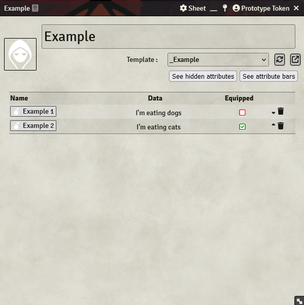

If you want to have a Checkbox in an Item Container to toggle e.g. the `equipped`-state of an Item, then you can follow this little guide to achieve this:

- Create a Label in the Item Container (this will be the Checkbox-column in the Container)
- Label text: `<i class="fa-regular fa-${item.equipped ? 'square-check' : 'square'}$ " style="color: ${item.equipped ? 'green' : 'red'}$; background-color: white;"></i>`
- Label Roll Message: `${setPropertyInEntity('item', 'equipped', "not(item.equipped)")}$`
- (Optional) Uncheck `Send roll message to chat` to avoid sending a Chat Message with every click

**Hint**: You'll still need a Checkbox (or any other Input Component) in your Item to **save** the current state, so don't forget that.

