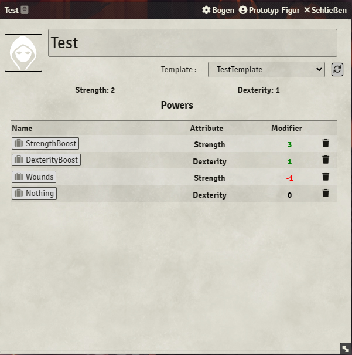

You can apply text color to a text, if you add a prefix with `
` (all color names can be found here: [https://www.w3schools.com/colors/colors_names.asp](https://www.w3schools.com/colors/colors_names.asp)). This example is very simple and already helps a bit with styling (if you don´t know CSS). But what, if you want the color to be applied to a condition (or even multiple ones)? Well, that´s not so hard actually and can be done pretty quick throughout your character sheets.

Let´s take an example: You have numbers ranging from positive to negative values, stored in the `modifier` field, and you want your positive numbers to be green, the negative ones red and the 0 should stay black. All you need to do is to use this formula as your prefix: `
 0 ? 'green' : modifier < 0 ? 'red' : 'black'}$";>`. All we do is to do a conditional check within the color-property to choose the right color-name. Pretty simple, right? And as you can see, the right color is indeed taken!

This formula works with every Label in your sheet, even for Labels in Dynamic Tables and Item Containers (Dynamic Table: `sameRow(<OwnLabelKey>)`, Item Container: `item.<ItemLabelKey>`). Just replace `modifier` with your own Key.

And, last but not least, you should add a suffix with `
`. It should still work without it (because HTML is quite tolerant) but it is recommended to close your opened HTML-Tags, so please do it if you can 😃 .
