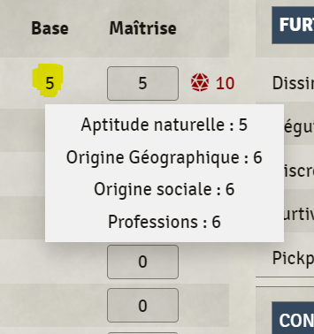

To have a tooltip on mouseover, you can use the dropdown div according to the example below. This not only allows you to
have a tooltip, but it also lets you place variables inside.

```html
<div class="dropdown">
  <p>${your-variable-to-show}$</p>
  <div class="dropdown-content">
    <p>your tooltip-text ${your-tooltip variable}$</p>
  </div>
</div>
```



**Beware**: This example uses Custom-CSS (instructions on how to add your own CSS-file can be found [here](https://gitlab.com/custom-system-builder/custom-system-builder#84-use-your-own-css)).

```css
.dropdown:hover .dropdown-content {
  display: block;
}
.dropdown .dropdown-content {
  position: absolute;
  transform: translateX(-50%);
  background: white;
  z-index: 9999;
  padding: 8px;
  display: none;
}
```
